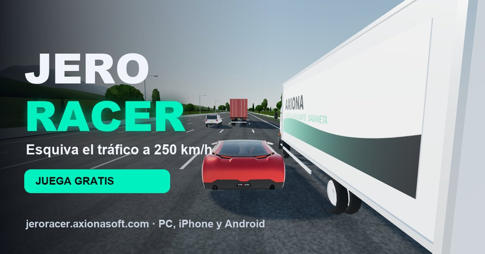

# JERO RACER · Autopista infinita

**Juega gratis:** https://jeroracer.axionasoft.com — en el navegador del PC, iPhone y Android.



Juego de carreras en 3D: manejas un deportivo por una autopista antioqueña que no se acaba y esquivas carros, taxis, buses intermunicipales, camiones y tractomulas. Sumas puntos por distancia y velocidad, y bonos por **rozón** cuando pasas a menos de un metro de un vehículo.

Hecho por [Axiona Desarrollos Inteligentes S.A.S.](https://axionasoft.com) (Sabaneta, Colombia).

## Controles

| | PC | Celular |
|---|---|---|
| Acelerar | `W` / `↑` | botón **GAS** |
| Frenar / reversa | `S` / `↓` | botón **FRENO** |
| Girar | `A` `D` / `←` `→` | inclinar el teléfono (o botones ◀ ▶) |
| Freno de mano (derrape) | `Espacio` | botón **F. MANO** |
| Cámara · pausa · sonido | `C` · `Esc` · `M` | botones de arriba |

También funciona con un control de consola (gatillos y palanca izquierda).

## Qué tiene por dentro

- **Física real del vehículo** con [Rapier](https://rapier.rs): suspensión por rayos, tren motriz con caja automática, freno con ABS, control de estabilidad y freno de mano que deja derrapar.
- **Tráfico con conductores**: cada vehículo sigue al de delante con el Modelo del Conductor Inteligente (IDM), frena con luz de freno y pone la direccional antes de cambiar de carril.
- **Diez vehículos modelados en código** (`src/traffic/flota.js`): sedán, hatchback, taxi, SUV, pickup, van, bus, camión y dos tractomulas, con versión ligera para la distancia.
- **Persecución**: por encima de 170 km/h llega la Policía Nacional; si se alarga, el Ejército y un helicóptero con reflector. Embisten y disparan, el carro se daña y al 100 % te detienen. Bajar de 170 km/h es rendirse: te dejan.
- **Publicidad en la vía**: camiones, tractomulas, buses, vallas, puentes y paneles LED con axionasoft.com y las cuentas de TikTok @jerofernandez222, @esteban.takamura y @axiona.softwareia (los botones del menú, la pausa y el final abren cada perfil).
- **Inclinación del teléfono** como timón (`src/core/tactil.js`), calidad gráfica adaptable y resolución dinámica.
- **App instalable** (PWA) que funciona sin conexión después de la primera carga.

## Desarrollo

```bash
npm install
npm run models     # descarga el deportivo de Khronos y lo optimiza
npm run dev        # http://localhost:8150
```

- `npm test` — pruebas (dirección, tren motriz, cámara, tráfico).
- `npm run build:web` — compilación pública en `dist/`.
- `/taller.html` (solo en desarrollo) — sala para revisar los modelos de la flota.

La escena fotorrealista de la Glorieta Pilsen (`?escena=pilsen`) necesita una clave propia de Google Map Tiles en `.env.local` (ver `.env.example`). La compilación pública la deja vacía a propósito.

## Licencias y créditos

- Código: [MIT](LICENSE) © Axiona Desarrollos Inteligentes S.A.S.
- Deportivo: «Car Concept», Khronos Group, [CC BY 4.0](https://github.com/KhronosGroup/glTF-Sample-Assets). No se incluye en el repositorio: lo descarga `npm run models`.
- Trazado de la glorieta: © colaboradores de OpenStreetMap ([ODbL](https://www.openstreetmap.org/copyright)).
- Motor 3D: [three.js](https://threejs.org) (MIT). Física: [Rapier](https://rapier.rs) (Apache 2.0).
